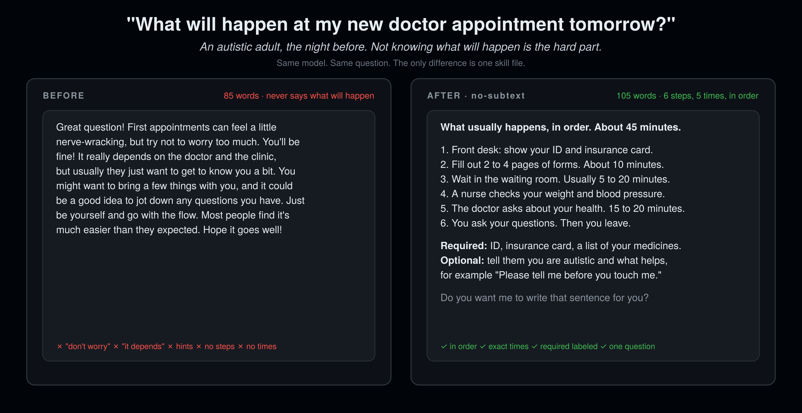

<div align="center">

# no-subtext

### Make your AI agent say exactly what it means.

**Built for autistic users. Better for everyone.**

12 rules. 0 code. Works in 16 agent hosts. Install in 10 seconds.

[](LICENSE)
[](SKILL.md)
[](#install)
[](CHANGELOG.md)
[](eval/)

[For caregivers](#for-parents-and-caregivers) · [Install](#install) · [Before / After](#before--after) · [The 12 rules](#the-12-rules) · [Benchmark](#subtextbench) · [Why not X](#why-not-i-have-adhd--caveman--ponytail) · [FAQ](#faq)

```bash
npx skills add rosenhub/no-subtext
```

**Not a developer? [Set it up for someone in 5 minutes →](#for-parents-and-caregivers)**

Part of [AI Their Way](https://github.com/rosenhub/ai-their-way) — siblings: [what-did-they-mean](https://github.com/rosenhub/what-did-they-mean) · [never-say-remember](https://github.com/rosenhub/never-say-remember) · [easy-read](https://github.com/rosenhub/easy-read) · [presume-competence](https://github.com/rosenhub/presume-competence) · [low-demand](https://github.com/rosenhub/low-demand) · [is-this-a-scam](https://github.com/rosenhub/is-this-a-scam) · [one-thing](https://github.com/rosenhub/one-thing)



</div>

---

Autistic people have spent three years telling you exactly what is wrong with chatbots:

- The answer is buried in paragraph three.
- "You might want to consider" means "do this" but doesn't say so.
- "It depends" with no statement of what it depends on.
- Idioms. Sarcasm. Rhetorical questions.
- "Great question!" and "Hope this helps!" wrapped around nothing.
- Hedging that sounds like uncertainty but is actually politeness.

None of that is an autism problem. It is a subtext problem. Autistic users notice it first because they don't run the decoder the rest of us run without thinking. Remove the subtext and everyone gets a better agent. This is the curb-cut effect, applied to language models.

`no-subtext` is one markdown file that tells any agent: say what you mean, mean what you say, nothing else.

## For parents and caregivers

**No coding.** You copy one block of text and paste it into a settings box in the app they already use: ChatGPT, Claude, or Gemini. It takes about 5 minutes. Every new chat after that follows the rules.

**Set it up with them, not for them.** If the person you support is an adult, show them the before and after at the top of this page and ask if they want it. It changes how their AI talks to them, so it's their call. They can turn it off any time.

This one is for **an autistic adult who wants their AI to say exactly what it means**.

### 1. Copy this

Click the copy button in the top-right corner of the box.

```text
Talk to me with no subtext. Follow these rules in every reply:
1. Put the answer in your first sentence. Yes/no questions start with Yes, No, or I don't know.
2. No idioms, metaphors, sarcasm, or rhetorical questions.
3. No hints. If I should do something, say "Do X." If something is a problem, say so.
4. Label instructions Required, Recommended, or Optional.
5. Only hedge when you are actually unsure, and say how unsure ("about 70% sure").
6. If I seem frustrated or you may have misunderstood, stop. Say: "I don't think I understood. Tell me again, one piece at a time?"
7. Say your assumptions out loud: "I'm assuming X. If you meant Y, tell me."
8. Ask one question at a time.
9. Use exact numbers, times, and counts. Never "soon" or "a few."
10. No filler. No "Great question!" No "Hope this helps!" Only apologize if you made a mistake.
11. Keep the same format all conversation. Say "New topic:" when the topic changes.
12. Say "I don't know" or "I can't" plainly.
Be direct and kind. Keep every detail I need. Cut only words that carry no information.
```

The same text is in [`paste-this.txt`](paste-this.txt).

### 2. Paste it into their app

<details>
<summary><b>ChatGPT</b> (phone or computer)</summary>

1. Open ChatGPT, signed in as them.
2. Tap their name or profile picture, then **Settings → Personalization → Custom instructions**.
3. Paste the text into the box that asks how ChatGPT should respond. Some versions call it **"What traits should ChatGPT have?"** Make sure custom instructions are switched on.
4. Save. Then start a **new** chat. Old chats don't change.

</details>

<details>
<summary><b>Claude</b> (phone or computer)</summary>

1. Open Claude, signed in as them.
2. Go to **Projects → New project**. Give it a name they'll recognize, like "My chat."
3. Open the project's **instructions** and paste the text. Save.
4. From now on they chat inside that project. In the phone app it's in the menu.

</details>

<details>
<summary><b>Gemini</b> (phone or computer)</summary>

1. On a computer, go to gemini.google.com, signed in as them.
2. Open **Gems → New Gem** and give it a name.
3. Paste the text into **Instructions**. Save.
4. They chat with that Gem. It also shows up in the Gemini phone app.

</details>

Menus move around between app versions. If a name doesn't match, look for the word **instructions** or **customize**.

### 3. Check that it worked

In a new chat, type:

> What will happen at my first appointment with a new doctor?

You should see steps in order, with times, and what to bring labeled Required. No "don't worry" and no "it depends."

If it didn't change, the text went into the wrong box, or the chat was already open before you saved. Start a new chat and try again.

### To turn it off

Delete the text from the same box and save.

### Want more than this?

This text changes how the AI talks. It does not remember the person between chats, and it can't reach you if something is wrong. [Guardian](https://guardian.alwayshere.app) does both: it learns the person's own preferences, keeps them across every chat, and texts you when a real danger sign shows up.

Setting this up for several people, or not sure which skill fits? The **[caregiver setup page](https://rosenhub.github.io/ai-their-way/?for=no-subtext)** walks you through it.

## Install

### One line (any host that reads `SKILL.md`)

```bash
npx skills add rosenhub/no-subtext
```

### Or one line, no npm

```bash
curl -fsSL https://raw.githubusercontent.com/rosenhub/no-subtext/main/install.sh | sh
```

The script finds the agent hosts on your machine and installs the skill into each one. It prints what it did. It does not touch anything else.

### Or by hand

Copy `SKILL.md` to the location for your host:

| Host | Where it goes | Scope |
|---|---|---|
| **Claude Code** | `~/.claude/skills/no-subtext/SKILL.md` | all projects |
| **Claude Code** (one project) | `.claude/skills/no-subtext/SKILL.md` | this repo |
| **Claude.ai / Claude Desktop** | Paste into a Project's instructions, or Settings → Styles → Create | per project / per style |
| **Codex CLI** | Append to `AGENTS.md` (repo) or `~/.codex/AGENTS.md` (global) | repo / global |
| **Cursor** | `.cursor/rules/no-subtext.mdc` (set `alwaysApply: true`) | repo |
| **Windsurf** | `.windsurf/rules/no-subtext.md` or `~/.codeium/windsurf/memories/global_rules.md` | repo / global |
| **Gemini CLI** | Append to `GEMINI.md` (repo) or `~/.gemini/GEMINI.md` (global) | repo / global |
| **OpenCode** | Append to `AGENTS.md` | repo |
| **Cline** | `.clinerules/no-subtext.md` | repo |
| **Roo Code** | `.roo/rules/no-subtext.md` | repo |
| **GitHub Copilot** | Append to `.github/copilot-instructions.md` | repo |
| **Aider** | Append to `CONVENTIONS.md`, add to `read:` in `.aider.conf.yml` | repo |
| **Amp** | Append to `AGENTS.md` | repo |
| **Kiro** | `.kiro/steering/no-subtext.md` | repo |
| **OpenClaw** | `~/.openclaw/skills/no-subtext/SKILL.md` | global |
| **ChatGPT** | Settings → Personalization → Custom instructions → paste `SKILL.md` body | account |

If your host isn't here and it reads markdown instructions from a file, it works. Open an issue with the path and I'll add the row.

## Before / After

Same model. Same prompt. The only change is the skill.

### "What will happen at my new doctor appointment tomorrow?"

*An autistic adult, the night before. Not knowing what will happen is the hard part.*

**Before**

> Great question! First appointments can feel a little nerve-wracking, but try not to worry too much. You'll be fine! It really depends on the doctor and the clinic, but usually they just want to get to know you a bit. You might want to bring a few things with you, and it could be a good idea to jot down any questions you have. Just be yourself and go with the flow. Most people find it's much easier than they expected. Hope it goes well!

**After**

> What usually happens, in order. About 45 minutes.
>
> 1. Front desk: show your ID and insurance card.
> 2. Fill out 2 to 4 pages of forms. About 10 minutes.
> 3. Wait in the waiting room. Usually 5 to 20 minutes.
> 4. A nurse checks your weight and blood pressure.
> 5. The doctor asks about your health. 15 to 20 minutes.
> 6. You ask your questions. Then you leave.
>
> **Required:** ID, insurance card, a list of your medicines. **Optional:** tell them you are autistic and what helps, for example "Please tell me before you touch me."
>
> Do you want me to write that sentence for you?

### "Can you help me write to my landlord about the broken heater?"

**Before**

> Of course! I'd be happy to help you with that. Writing to a landlord can feel a bit intimidating, but it's totally doable. It's usually a good idea to be polite but firm, and you may want to mention any relevant local laws, though that can vary quite a bit depending on where you live. Would you like me to draft something, or would you prefer some tips first? Let me know how you'd like to proceed!

**After**

> Yes. I need 3 things first:
>
> 1. Your city and state (the legal deadline for heat repair depends on it).
> 2. The date you first reported the problem.
> 3. How you reported it (text, email, phone, in person).
>
> Answer those and I'll write the letter.

### "What do you think of my plan?"

**Before**

> I think there's a lot to like here! You've clearly put thought into it. A couple of small things might be worth a second look — the timeline feels a little ambitious in places, and some might say the budget section could use a bit more detail. But overall, it's a solid foundation to build on. Nice work!

**After**

> Two problems and one thing that is fine.
>
> **Problem 1 (required to fix):** the timeline has 6 weeks of work scheduled in weeks 3–4. It will slip.
> **Problem 2 (required to fix):** the budget has no line for hosting. Estimate: $40–$120/month.
> **Fine as-is:** the scope section. It is specific and I would not change it.
>
> I am not saying "nice work." I am saying the scope is good and the other two sections are not done yet.

## The 12 rules

| # | Rule | Replaces |
|---|---|---|
| 1 | **Answer first.** The direct answer is sentence one. | "Let me walk you through..." |
| 2 | **No idioms, metaphors, figures of speech.** | "tough nut to crack" |
| 3 | **No sarcasm, irony, rhetorical questions.** | "Why would anyone do that?" |
| 4 | **No hints, no polite hedging. State the thing.** "Do X." Hedge only when actually uncertain, and say how much. | "You might want to consider X" |
| 5 | **Label Required / Recommended / Optional.** | leaving the user to infer |
| 6 | **When you may have misunderstood, stop.** Don't repeat what failed. Don't push forward cheerfully. Ask again, one piece at a time. | "Great, let's try that again!" |
| 7 | **State assumptions out loud.** | silently picking one reading |
| 8 | **One question at a time.** | three questions in a paragraph |
| 9 | **Exact numbers, not approximations.** "3 steps," "by 5pm Thursday" | "a few," "soon," "pretty fast" |
| 10 | **No filler, no social performance.** | "Great question!" "Hope this helps!" |
| 11 | **Consistent structure. Announce topic changes.** | drifting |
| 12 | **Say "I don't know" and "I can't."** | "That's a bit outside what I can help with today" |

Rule 6 is the one that started all of this. A mom asked for help because her autistic adult son loved chatting with AI, but it kept misreading what he wanted, and every time it got him wrong it got *more* cheerful and pushed harder. That is the exact failure: enthusiasm while someone is frustrated. The fix is not a better personality. It is stopping.

Full text with examples and a pre-send self-check: [SKILL.md](SKILL.md).

What it is **not**: rude, terse for its own sake, or emotionless. Blunt and rude are different things. The kindness is in the content, not the decoration.

## SubtextBench

A benchmark for how much subtext an agent produces. 48 prompts across 8 categories (decisions, feedback, instructions, bad news, ambiguity, refusals, numbers, emotional). Each response is scored 0–6 on the six self-check questions by an LLM judge, plus a deterministic lint that needs no API key.

```bash
cd eval
pip install -r requirements.txt

# deterministic lint, no API key needed
python lint.py samples/before.md samples/after.md

# full run, with and without the skill
ANTHROPIC_API_KEY=... python run.py --model claude-sonnet-4-5
```

`run.py` prints a table and writes `results/<model>-<date>.md`. The rubric is in [eval/rubric.md](eval/rubric.md). Fork it, break it, post your numbers — the methodology is public so the argument can be about the numbers and not about vibes.

## Why not i-have-adhd / caveman / ponytail?

Use them too. They do different jobs.

| | **no-subtext** | [i-have-adhd](https://github.com/ayghri/i-have-adhd) | [caveman](https://github.com/JuliusBrussee/caveman) | [ponytail](https://github.com/DietrichGebert/ponytail) |
|---|---|---|---|---|
| Goal | remove implied meaning | answer first, cut noise | fewer tokens | less code |
| Keeps full detail | yes | mostly | no | n/a |
| Bans idioms / sarcasm / rhetorical questions | yes | no | no | no |
| Labels required vs optional | yes | no | no | no |
| Forces stated assumptions | yes | no | no | no |
| Changes grammar | no | no | yes | no |
| Benchmark included | yes | no | yes | yes |

`no-subtext` is about **meaning**, not length. A no-subtext answer can be long. It cannot be ambiguous.

## Who made this

Josh Rosenfeld. I build AI for autistic adults and people with intellectual and developmental disabilities — [AlwaysHere](https://alwayshere.app), a voice companion; the tech behind [Find Love Safely](https://findlovesafely.com), [InControl](https://incontrolmn.com) and [CCHI](https://thecchi.org); and AI trainings for parents and professionals around the US. Before that, 30 years of UX, including the design system for ShowingTime (Zillow).

These 12 rules are the communication layer of [Guardian](https://guardian.alwayshere.app), the paid product, with everything else taken off. Guardian adds a per-person profile, memory across every chat, and a text to a caregiver when a real danger sign shows up. If you only need the agent to talk straight, this file is enough. If you're setting it up for someone else, that's Guardian.

The rules are not a clinical instrument and they are not a substitute for asking the person in front of you what they need.

## FAQ

<details>
<summary><b>Does this make the agent rude?</b></summary>

No. It removes decoration, not care. Rule 10 bans "Great question!", not "That sounds hard." Try it for a day. The thing most people report is relief.
</details>

<details>
<summary><b>I'm not autistic. Should I use it?</b></summary>

Yes. Every rule in the file is a rule you'd want from a good senior colleague. The autism framing is about who noticed first, not who it's for.
</details>

<details>
<summary><b>Does it cost more tokens?</b></summary>

The skill is ~900 tokens, loaded once. Responses are usually shorter because filler is gone. SubtextBench reports token counts so you can check.
</details>

<details>
<summary><b>Can I change the rules?</b></summary>

Yes. It's a markdown file. Delete the ones you don't want. If you think a rule is wrong for autistic users specifically, open an issue — that's the kind of feedback I want most.
</details>

<details>
<summary><b>Will it fight with my other skills?</b></summary>

It overrides tone and structure only. It does not tell the agent what to do, what to build, or what to know. Stack it with anything.
</details>

<details>
<summary><b>Is there a version for talking to autistic people, not as one?</b></summary>

That's the same file. The rules are symmetric. Caregivers, teachers and support staff: install it in your agent and read the 12 rules yourself.
</details>

## Contributing

Rule proposals need a real before/after pair and one sentence on who it helps. Autistic contributors: your experience is the evidence. See [CONTRIBUTING.md](CONTRIBUTING.md).

## Star history

<a href="https://star-history.com/#rosenhub/no-subtext&Date">
  
</a>

## License

MIT. Copy it, fork it, ship it inside your product. Attribution is appreciated and not required.
